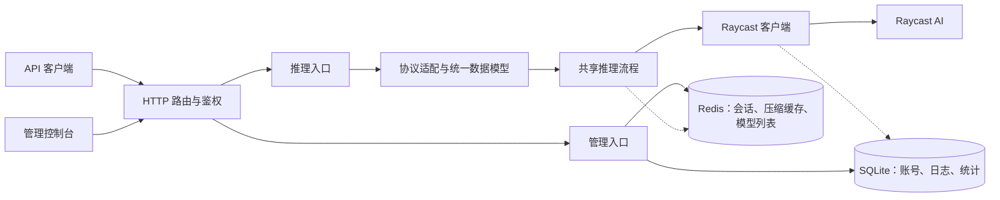

<div align="center">

# raycast2api

**将 Raycast AI 接入 OpenAI / Anthropic 兼容客户端的自托管 HTTP 网关**

适用于 Claude Code、Codex 和其他兼容客户端。

[](https://www.rust-lang.org/)
[](https://github.com/jwyGithub/raycast2api/tags)
[](https://github.com/jwyGithub/raycast2api/pkgs/container/raycast2api)
[](https://github.com/jwyGithub/raycast2api/actions/workflows/docker-publish.yml)
[](https://github.com/jwyGithub/raycast2api/commits/main)
[](https://github.com/jwyGithub/raycast2api/stargazers)
[](https://github.com/jwyGithub/raycast2api/issues)

[核心功能](#核心功能) · [快速运行](#快速运行) · [请求示例](#请求示例) · [配置说明](#配置说明) · [项目架构](#项目架构) · [项目结构](#项目结构) · [开源协议](#开源协议) · [免责声明](#免责声明)

</div>

## 核心功能

* **协议兼容**：支持 OpenAI Chat Completions、OpenAI Responses 和 Anthropic Messages，提供文本、工具调用、流式与非流式响应。
* **模型与上下文**：查询可用模型、配置模型别名，支持为 Responses 请求自动压缩长对话。
* **多账号池**：在可用账号之间轮询，支持令牌续期、限额冷却与换号重试。
* **管理控制台**：在网页中导入和管理账号，查看模型并配置模型别名，查看请求日志与调用统计。请求日志保留 7 天。

## 快速运行

### 准备配置

```bash
git clone https://github.com/jwyGithub/raycast2api.git
cd raycast2api
cp config.example.json config.json
```

编辑 `config.json`，填写必需的 `raycast_signature_secret` 和全局 `api_key`。需要网页登录时，设置 `dashboard_password` 和至少 32 字节的随机 `dashboard_session_secret`，并准备可连接的 Redis。字段和默认值见[配置说明](#配置说明)。

### Docker Compose（推荐）

[Docker Compose 配置](./docker-compose.yml)默认使用 `ghcr.io/jwygithub/raycast2api:latest`，连接已有的 Redis（`host.docker.internal:6379`）。如果 Redis 地址不同，修改 Compose 中的 `REDIS_HOST` 和 `REDIS_PORT`；需要认证时，在 `.env` 中设置 `REDIS_USERNAME` 和 `REDIS_PASSWORD`。

```bash
docker compose up -d
```

保留 `config.json` 中的监听配置 `0.0.0.0:8787`，以匹配默认端口映射。账号、日志和统计默认持久化到 `./store/store.db`，需确保 Compose 中 `user` 指定的用户可写入 `./store`。修改 `config.json` 后重启容器，修改 Compose 环境变量后重新执行 `docker compose up -d`。

### 源码运行

使用支持 Rust 2024 Edition 的工具链。本例假设 Redis 监听本机默认端口：

```bash
REDIS_HOST=127.0.0.1 cargo run --release
```

### 导入账号

发起推理请求前，至少导入一个可用账号。打开 `http://localhost:8787/`，用控制台密码登录后选择「导入账号」。也可用网关 API Key 调用 `POST /v1/accounts/create`，例如：

```bash
curl http://localhost:8787/v1/accounts/create \
    -H 'Authorization: Bearer <api_key>' \
    -H 'Content-Type: application/json' \
    -d '{
        "user": {"email": "you@example.com"},
        "access_token": "<access_token>",
        "refresh_token": "<refresh_token>"
    }'
```

控制台和接口均接受单个 JSON 对象或数组，按 `user.email` 识别账号。`refresh_token` 可选，用于自动续期。

账号调度相关字段（均可选）：

* `enabled`：默认 `true`。设为 `false` 即停用账号，停用后不参与选号，也不发起额度查询等普通上游请求，仅允许必要的 token 续期。需要先启用才能刷新或恢复。
* `priority`：整数，默认 `0`，取值范围 `i32`，数值越大越优先。请求只在最高优先级档内轮询，该档全部不可用（停用、摘除或冷却）时才使用低档账号。高档仍有可调度账号时，低档保持备用，不主动调用上游查询接口；手动刷新或恢复备用账号返回 409。

冷却期间同样不发起额度查询等普通上游请求，冷却到期或显式恢复后才恢复调用。手动刷新停用或冷却中的账号返回 409，控制台也会禁用相应的刷新按钮。

必要的 token 续期是冷却、停用和备用账号的唯一例外：仅在上游明确返回 401，或已知 access token 将在一分钟内过期时调用 OAuth 续期接口，不附带 `/me`、额度等查询，也不改变账号健康状态、启停、冷却或优先级。可在导入时通过 `access_token_expires_at` 提供 Unix 秒格式的过期时间，续期响应的 `expires_in` / `expires_at` 也会保存。过期时间未知时不猜测、不定期轮换，恢复使用后按需续期。网络失败会退避，`invalid_grant` 会停止重试该凭据，需重新授权。

数组导入是原子的：任一条目非法（如 device_id 不合法、`priority` 越界），整批回滚，不会留下部分账号。

重复导入同一账号且不带这两个字段时，已有的开关与优先级保持不变；显式给出则覆盖。`null` 等同于省略。

账号详情中的 `available` 表示 token 与额度的健康状态；`schedulable` 表示当前是否参与选号（未停用、未摘除、不在冷却）。停用账号的 `available` 可以为 `true`，但 `schedulable` 为 `false`。

启停与优先级可单独修改，不必重新导入：

```bash
curl http://localhost:8787/v1/accounts/update \
    -H 'Authorization: Bearer <api_key>' \
    -H 'Content-Type: application/json' \
    -d '{"email": "you@example.com", "enabled": false, "priority": 10}'
```

`enabled` 与 `priority` 至少传一个，`update` 只修改启停与优先级，不会修改 token、tag 或 device_id。`priority` 超出 `i32` 范围时返回 400。

## 请求示例

以下示例使用默认地址 `http://localhost:8787`。将 `<api_key>` 替换为全局 Key 或控制台创建的托管 Key，将 `<模型 ID>` 替换为模型列表返回的 `data[].id`。网关接受 `Authorization: Bearer <api_key>` 或 `x-api-key: <api_key>` 两种鉴权头。

### 查询可用模型

```bash
curl http://localhost:8787/v1/models \
    -H 'Authorization: Bearer <api_key>'
```

### OpenAI Chat Completions

```bash
curl -N http://localhost:8787/v1/chat/completions \
    -H 'Authorization: Bearer <api_key>' \
    -H 'Content-Type: application/json' \
    -d '{
        "model": "<模型 ID>",
        "messages": [{"role": "user", "content": "你好"}],
        "stream": true,
        "stream_options": {"include_usage": true}
    }'
```

### Anthropic Messages

```bash
curl http://localhost:8787/v1/messages \
    -H 'x-api-key: <api_key>' \
    -H 'Content-Type: application/json' \
    -d '{
        "model": "<模型 ID>",
        "max_tokens": 1024,
        "messages": [{"role": "user", "content": "你好"}]
    }'
```

### OpenAI Responses

```bash
curl http://localhost:8787/v1/responses \
    -H 'Authorization: Bearer <api_key>' \
    -H 'Content-Type: application/json' \
    -d '{
        "model": "<模型 ID>",
        "input": "你好",
        "reasoning": {"effort": "medium"}
    }'
```

三个推理接口均可设置 `"stream": true` 获取流式响应，请求体上限为 16 MiB。部署时可用 `GET /health` 检查服务是否存活，用 `GET /ready` 检查是否就绪；两者均无需鉴权。

## 配置说明

网关从工作目录读取 `config.json`，参考[配置模板](./config.example.json)。Redis 单独通过环境变量配置。配置在启动时加载。

| 配置项 | 默认值 | 说明 |
| --- | --- | --- |
| `raycast_signature_secret` | 无 | 必填，Raycast 请求签名密钥。 |
| `api_key` | 必填 | 全局 Key，允许管理和推理。使用不含空白的可见 ASCII 字符，不能与已有托管 Key 相同。 |
| `dashboard_password` | 无 | 控制台登录密码。未配置时无法登录控制台。 |
| `dashboard_session_secret` | 无 | 启用控制台时必填，至少 32 字节，可用 `openssl rand -hex 32` 生成。 |
| `host` / `port` | `0.0.0.0` / `8787` | HTTP 监听地址和端口。 |
| `accounts_db` | `store/store.db` | 账号、托管 API Key、请求日志和调用统计共用的 SQLite 文件。 |
| `upstream_timeout_secs` | `20` | 转发请求的超时秒数，须为正整数。流式响应持续有输出时，总时长可超过此值。 |
| `proxies` | `[]` | 代理 URL 列表，支持 HTTP、HTTPS 和 SOCKS5。 |
| `proxies_mode` | `direct` | 上游通道模式：`direct` 只直连，失败即失败；`proxy` 只走代理（按序尝试），全部失败即失败，不回退直连；`proxy_fallback_direct` 先走代理，全部失败再回退直连。`proxy` 和 `proxy_fallback_direct` 要求 `proxies` 非空，否则启动失败。 |

可通过环境变量 `RUST_LOG` 调整日志级别，默认 `info,tower_http=info`。

### Redis 环境变量

| 变量 | 默认值 | 说明 |
| --- | --- | --- |
| `REDIS_HOST` | 无；Compose 为 `host.docker.internal` | Redis 地址。未配置时不连接 Redis，且需禁用控制台登录。 |
| `REDIS_PORT` | `6379` | Redis 端口。 |
| `REDIS_USERNAME` / `REDIS_PASSWORD` | 无 | Redis 认证凭据。 |
| `REDIS_DB` | `0` | Redis 数据库编号。 |
| `REDIS_KEY_PREFIX` | `raycast2api` | Redis 键的命名空间。 |

控制台的会话保存在 Redis，固定有效 24 小时。管理接口可用有效会话或网关 API Key 调用；推理和模型接口使用独立的 API Key 规则。仅运行 API 时，可省略 `dashboard_password` 和 `REDIS_HOST`；Compose 默认设置了后者，需一并移除或留空。配置 Redis 后，模型列表也会在 Redis 中共享缓存 24 小时（键 `<prefix>:models:v1`）；上游模型变化最长约一天后才可见，可用 `redis-cli DEL` 删除该键强制刷新，详见 [Redis 会话与缓存](./doc/redis.md)。

请勿提交 `config.json`、`.env` 或 `store/`。SQLite 文件包含账号凭据和请求内容，应限制访问。

## 项目架构

HTTP 层将推理接口与管理接口分开。推理请求先由协议适配器转换为统一请求，再交给共享流程解析模型、调度账号和发起调用。返回的数据转换为统一事件，由对应的协议适配器输出流式响应或聚合后的 JSON。



## 项目结构

```text
src/
    main.rs                       服务启动与后台维护任务
    config.rs                     运行配置
    storage/                      共享存储基础设施(SQLite 连接、diesel 表定义、Redis 连接)
    core/                         统一请求、响应与事件类型
    protocol/                     三种客户端协议的输入与输出适配
    raycast/                      Raycast 客户端与模型解析
    account/                      账号存储、续期与额度刷新
    model/                        模型别名存储
    server/                       HTTP 路由、中间件、推理流程与会话
        handlers/
            inference/            推理与模型查询接口
            management/           登录、账号、日志、模型和统计接口
    log/                          请求日志
    statistics/                   调用统计
    page/                         内置管理控制台
        views/                    账号、日志、模型与统计面板
        components/               共享组件
deploy/                           部署辅助脚本
doc/                              项目文档
tests/                            接口与行为测试
config.example.json               应用配置模板
docker-compose.yml                容器部署配置
Dockerfile                        容器镜像构建
```

## 延伸文档

[Redis 会话与缓存](./doc/redis.md) · [调用统计与查询接口](./doc/statistics.md)

## 开源协议

本项目采用 [MIT License](./LICENSE) 开源。

## 免责声明

**授权说明：** 下文与 [MIT License](./LICENSE) 不一致时，软件授权范围以 MIT License 为准。

在使用此项目时均被视为已经仔细阅读并完全同意以下条款：

* 此项目仅供个人学习与交流使用，严禁用于商业以及不良用途。
* 如有发现任何商业行为以及不良用途，此项目作者有权撤销使用权。
* 使用本软件所存在的风险将完全由其本人承担，此项目作者不承担任何责任。
* 此项目注明之服务条款外，其它因不当使用本软件而导致的任何意外、疏忽、合约毁坏、诽谤、版权或其他知识产权侵犯及其所造成的任何损失，本软件作者概不负责，亦不承担任何法律责任。
* 对于因不可抗力或因黑客攻击、通讯线路中断等不能控制的原因造成的服务中断或其他缺陷，导致用户不能正常使用，此项目作者不承担任何责任，但将尽力减少因此给用户造成的损失或影响。
* 本声明未涉及的问题请参见国家有关法律法规，当本声明与国家有关法律法规冲突时，以国家法律法规为准。
* 本软件相关声明版权及其修改权、更新权和最终解释权均属此项目作者所有。

## 账号级 Mihomo 代理

镜像内固定包含 Mihomo v1.19.34，下载资源及 SHA-256 记录在 `build/mihomo-lock.json`。在 `config.json` 中设置 `proxy_manager.enabled: true`，并通过 Compose 的 `.env` 配置 `PROXY_ENCRYPTION_KEY`（Base64 编码、解码后恰好 32 字节的随机密钥）。例如使用 `openssl rand -base64 32` 生成后安全保存，不提交到 Git。默认配置见 `config.example.json`。

重建镜像并启动后，控制台「代理管理」可以添加 HTTPS Clash/Mihomo YAML 订阅、刷新节点、停用订阅和手动测试延迟；账号卡片「代理出口」用于绑定或解绑。新增订阅会排队首次导入。配置操作返回含 `id` 的操作对象（HTTP 202），必须等待状态 `committed` 才表示生效，失败可在界面查看原因。

下载并发由 `proxy_manager.subscription_concurrency` 控制，手动测速并发由 `manual_test_concurrency` 控制，默认均为 3、可配置 1–32。两类任务各自限流，配置应用保持串行。同一订阅刷新、同一节点测速会复用正在排队或执行的任务，完成后可再次主动执行。定时刷新在周期后增加 1 秒至周期的 10%（最多 300 秒）的随机延迟，`next_refresh_at` 持久化保存，重启沿用计划。

控制台支持「批量添加」（每行一个 HTTPS 地址，或 `名称 | HTTPS地址`，每批 1–50 项）、「刷新全部」及勾选最多 20 个节点批量测速。批量结果逐项展示，部分失败不影响其余任务。批量添加提交成功表示订阅已保存，启用项的首次导入另行排队。

代理变更请求自动携带 `Idempotency-Key`，网络失败后的同请求重试复用该键；后端按已认证 API 密钥/控制台会话及接口隔离，同键不同内容返回 409。幂等记录与任务在同一事务中持久化，重启后仍可查询。批量接口为 `POST /v1/proxy/subscriptions/create-batch`（`{"items":[{"url":"https://example.com/sub","name":"示例"}]}`）、`POST /v1/proxy/subscriptions/refresh-all` 和 `POST /v1/proxy/nodes/test-batch`（`{"ids":["节点ID"]}`）。单个/批量测速和刷新均返回 202，使用 `POST /v1/proxy/operations/detail`（`{"id":"操作ID"}`）等待 `committed`，并读取 `result` 中的逐项结果、成功数量和延迟；`committed` 表示批次处理完成，仍须检查各项 `success`。

一个账号固定使用一个节点及一个内部入口，多个账号可以共享节点。绑定节点失效、缺失、订阅停用或核心不可用时拒绝该账号的请求，不使用其他节点、全局代理或直连。已有绑定时关闭模块也会阻断；只有显式解绑恢复全局策略。内部入口默认 `127.0.0.1:18000–18999`，控制器 `127.0.0.1:19090`，**不要发布这些端口**。核心不接管宿主机网络、不自动测速。

聊天、文件注册及预签名 PUT、生成图片下载、账号查询与必要 token 续期使用同一账号出口。绑定账号的 SSE 异常截断不自动重放；图片下载失败返回错误，不回传原始链接让客户端另行抓取。停用、冷却、低优先级待命账号仍不发普通上游请求，必要续期沿用原规则；代理故障不会触发跨出口 OAuth 重放。已发送的轮换请求即使调用方断开，也会完成响应处理并保存结果。

配置应用会短暂暂停绑定账号的新请求，排空期间可能中断普通在途请求；已发送 OAuth 不强行取消。下载失败/无效订阅保留上次成功数据，有效订阅移除节点时清理未绑定旧节点，已绑定节点保留失效记录并阻断。节点列表默认仅显示当前节点，可切换查看失效绑定节点；解除最后一个绑定后清理失效记录。节点名称、协议或服务器改变时不自动迁移绑定；凭据变化可保留节点身份。当前采用完整代次重载，一个工作目录和数据库只支持一个管理实例。

订阅默认直接下载，不继承环境代理，20 秒超时、解压后 10 MiB、每订阅 10000 节点。默认拒绝内网地址，确需访问时配置 `subscription_allowed_private_hosts` 主机白名单；使用 `subscription_download_route: "global"` 时也必须明确白名单，因为远程代理负责解析目标。最多跟随 3 次重定向，每跳重新验证。V1 不导入订阅规则、脚本、TUN、链式代理及本地插件，拒绝未知协议和重复节点名；WebSocket 等传输参数保留并交给固定核心校验。地区标签仅由节点名称推断，不保证地理位置。

订阅 URL、节点完整配置及待执行操作加密入库，派生 Provider 文件包含解密后的凭据，目录/文件权限分别为 0700/0600。备份必须同时安全保存数据库、`store/mihomo` 和加密密钥。密钥错误会拒绝启动绑定流量；轮换密钥需停机备份并重新加密。恢复使用 SQLite 最后提交代次，不自动提升未提交配置。

验证命令（使用专用测试环境，不使用账号池凭据）：

```bash
cargo test --locked
# MIHOMO_TEST_BINARY 指向已校验的本机架构 v1.19.34 核心
MIHOMO_TEST_BINARY=/absolute/path/to/mihomo cargo test --locked real_core_binding -- --ignored --nocapture
MIHOMO_BINARY=/absolute/path/to/mihomo python3 tests/proxy/mihomo_contract.py
```

核心契约覆盖双入口隔离、无匹配/空 Provider/停用拒绝及禁止自动外联。CI 在 amd64、arm64 分别验证核心及网关测试再构建。详细设计、资源边界和故障注入清单见 `writing-block.md`。
